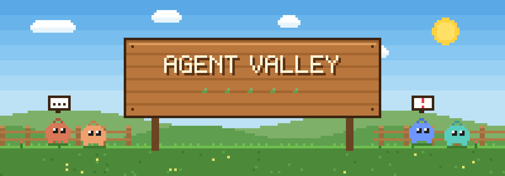

<p align="center">
  
</p>

<p align="center">
  <b>Run your Claude Code and Codex agents without leaving Pelican Town.</b><br>
  <sub>A SMAPI mod for Stardew Valley · Windows & macOS · English and French</sub>
</p>

<p align="center">
  
  
  
  
</p>

---

## 🌱 What is it?

Plant a **Junimo** on your farm, in the saloon or down in your cellar, and hand it a code folder. It's a real **Claude Code** or **Codex** agent: it reads your files, runs commands and edits your project while you water your cauliflowers.

When it's done, it **calls you**: your phone rings and a card pops up with its message, "All done, what should I do next?". You reply on the spot, even from the depths of the Secret Woods.

| | |
| --- | --- |
| 🟠 **Orange Junimo** | a Claude Code agent |
| 🔵 **Blue or green Junimo** | a Codex agent |
| 💬 **"…" bubble** | it's working |
| ❗ **"!" bubble** | it's done and waiting for you |
| ❌ **"X" bubble** | it hit a problem |

## 🏡 How it works

- **Real sessions.** Every message starts the official CLI in the background (`claude -p` in stream-json, or `codex exec --json`) and resumes the same session. The agent keeps the whole conversation in context.
- **Persistent agents.** The processes live outside any map: you can change location, go to sleep or open your inventory, and the agent keeps going. When you start the game again, it's still in its spot and remembers everything.
- **Your save stays untouched.** Agents are stored in `Mods/AgentValley/data/<save>.json`. The game's save file is never modified, so you can play on your real farm, and removing the mod leaves no trace.
- **Notifications everywhere:**
  - a ring and a call card when you're on another map;
  - a "!" above its head;
  - a Windows or macOS notification when you're in another window.
- **An escape hatch.** The *Terminal* button opens a real terminal on the same session, so you can take over outside the game.

## 🎮 Controls

| Key | Action |
| --- | --- |
| `F8` | Create an agent (type, name, folder, permissions, model), then place it at the cursor |
| `Right click` on an agent | Open the chat |
| `F5` | Expand or collapse the agents **side panel** (left edge of the screen) |
| `F7` | The **phone**: all your agents, with *Chat*, *Go there* (warp) and *Here* (it comes to you) |
| `F6` | Answer the last agent that called you |
| `Click` on a call card | Open that agent's chat |

### 🗂️ The side panel

On the left edge, a tab shows your agents, their status and a preview of their last message. Click an agent to open its chat **docked on the side**: the farm stays visible. Tabs at the top of every chat let you switch from one agent to another, and unsent messages are kept as drafts for each one.

### 💬 In the chat

- `Enter` sends the message, `Shift+Enter` adds a new line and `Ctrl/Cmd+V` pastes.
- A message sent while the agent is working goes out as soon as its turn ends.
- Buttons: *Stop*, *Mode*, *Move*, *Folder*, *Terminal*, *Reset*, *Delete* and *Dock* / *Expand*.

### ⌨️ `/` commands

Type `/` to open **autocompletion**. `Tab` completes the command, `Up`/`Down` changes the selected suggestion.

| Command | Effect |
| --- | --- |
| `/help` | List of commands |
| `/stop` | Stops the agent and the running shell command |
| `/new` | New session: the agent starts from scratch |
| `/mode yolo\|edits\|readonly` | Changes permissions |
| `/model opus` | Changes the model |
| `/rename Gus` | Renames the agent |
| `/cd [path]` | Opens the folder, or changes the working folder |
| `/terminal`, `/login` | Opens the session, or a login, in a real terminal |
| `/move`, `/copy`, `/delete confirm` | Moves the agent, copies its last reply, deletes it |

Every other command goes to **Claude Code**: `/compact`, `/context`, `/code-review`, your skills and custom commands. Autocompletion lists them too, as Claude Code announces them.

### 🐚 `!` shell

`!git status`, `!npm test`… runs the command in the agent's folder and streams its output into the chat. The shell is PowerShell on Windows (configurable: `pwsh` or `cmd`) and your `$SHELL` on macOS. Like Claude Code's `!` mode, the command and its output are attached to your next message to the agent.

All keys can be changed in `Mods/AgentValley/config.json`, created on first launch.

## 🧺 Installation

1. Install **[SMAPI](https://smapi.io)**.
2. Install the CLIs and log in once from a terminal:
   - **Claude Code** ([claude.com/claude-code](https://claude.com/claude-code)): run `claude`, then `/login`;
   - **Codex**: `npm install -g @openai/codex`, then `codex login`.
3. Drop the `AgentValley` folder (from a release zip, or built as shown below) into `Stardew Valley/Mods/`.
4. **Launch the game through SMAPI:**
   - **Steam on Windows:** in *Properties > Launch options*, set
     `"<game folder>\StardewModdingAPI.exe" %command%`.
   - **Steam on macOS:** the SMAPI installer takes care of it.

On startup, the SMAPI console tells you whether `claude` and `codex` were found. On macOS, the mod reads the `PATH` from your login shell, which covers nvm, Homebrew, etc. If a CLI still can't be found, set `ClaudePath` / `CodexPath` in `config.json`.

## 🔨 Building

You need the .NET 6 SDK or newer.

```bash
dotnet build AgentValley -c Release
```

The build copies the mod into `Mods/` (the game is detected automatically) and creates a zip in `AgentValley/bin/Release/net6.0/`.

## ⚠️ Permissions

Nobody can approve permission prompts from inside the game, so each agent runs in a fixed mode. You can switch it at any time with the *Mode* button:

| Mode | Claude Code | Codex |
| --- | --- | --- |
| 🔥 **YOLO** (default) | `--dangerously-skip-permissions` | `--dangerously-bypass-approvals-and-sandbox` |
| ✏️ **Auto edits** | `--permission-mode acceptEdits` | `--sandbox workspace-write` |
| 👀 **Read only** | `--permission-mode plan` | `--sandbox read-only` |

In YOLO mode, the agent runs any command in its folder without asking. Choose that folder carefully.

## 🌍 Translations

All in-game text lives in `AgentValley/i18n/`. `default.json` is English and `fr.json` is French; SMAPI picks the file that matches your game language. To add a language, copy `default.json` to `<code>.json` (for example `de.json`, `es.json` or `pt.json`) and translate the values.

## 📜 Quest log

- [x] Claude Code and Codex agents placed in the world
- [x] Persistent sessions, message queue
- [x] Calls, notification cards, system notifications
- [x] Phone (`F7`) with warping and recalling agents
- [x] `/` commands in the chat, with autocompletion
- [x] `!command` shell in the chat
- [x] Agents side panel and docked remote chat
- [x] English and French translations
- [ ] Generic Mod Config Menu integration
- [ ] Screenshots and a Nexus release

## 📄 License

[MIT](LICENSE) © 2026 Younes Khelifi

<sub>Stardew Valley is a trademark of ConcernedApe. This is a fan-made mod, not affiliated with ConcernedApe, Anthropic or OpenAI.</sub>
